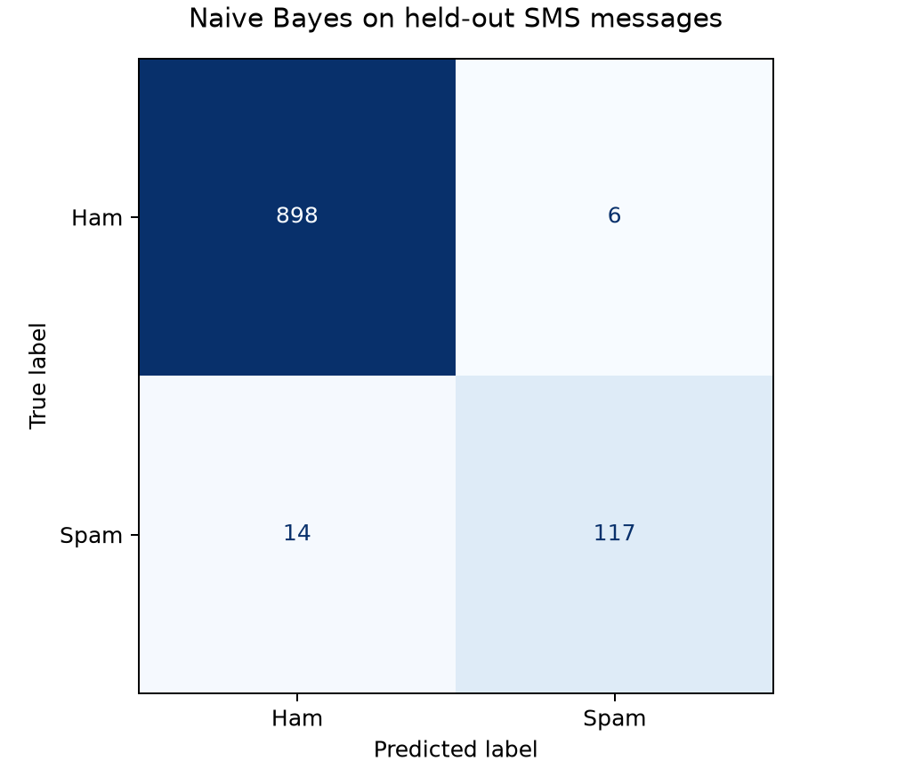

# Model evaluation

## Data preparation

The cleaned dataset contains 5,171 messages. A stratified split with test_size=0.20 and random_state=42 allocates 4,136 messages to training and 1,035 to testing. The proportions are approximately 80% and 20% because sample counts must be integers.

| Class | Training | Testing |
| --- | ---: | ---: |
| Ham | 3,614 | 904 |
| Spam | 522 | 131 |
| Total | 4,136 | 1,035 |

Exact duplicate messages were removed before splitting. The partitions have no shared source records or exact message text. The source-line assignments are saved in split_manifest.csv.

## Model

The pipeline uses CountVectorizer() and MultinomialNB() with default parameters. The vectorizer lowercases text and counts tokens containing at least two word characters, with no stemming or stop-word removal. The classifier uses alpha=1 additive smoothing. Only training messages are used to fit the vocabulary and model. The resulting vocabulary has 7,669 tokens.

Test messages are transformed using the fitted vocabulary; unseen words are ignored. No settings are tuned using the test set. The saved pipeline remains fitted on the training partition only.

## Held-out results

| Metric | Result |
| --- | ---: |
| Accuracy | 98.0676% |
| Spam precision | 95.1220% |
| Spam recall | 89.3130% |
| Spam F1-score | 0.921260 |
| Always-ham baseline accuracy | 87.3430% |

Spam is the positive class. Accuracy is (898 + 117) / 1035. Spam precision is 117 / (117 + 6), recall is 117 / (117 + 14), and F1 is 2 × 117 / (2 × 117 + 6 + 14).

The complete per-class report, including macro and weighted averages, is saved in classification_report.txt and model_metrics.json.

## Confusion matrix

Rows are actual labels and columns are predictions.

| Actual label | Predicted ham | Predicted spam |
| --- | ---: | ---: |
| Ham | 898 true negatives | 6 false positives |
| Spam | 14 false negatives | 117 true positives |

The model missed 14 of 131 spam messages (10.69%) and flagged 6 of 904 genuine messages (0.66%). Misclassified messages, source line numbers, actual labels, predicted labels and estimated probabilities are saved in misclassified_messages.csv. The notebook displays examples of both error types.

## Verification and limits

All 13 unit tests passed. The full notebook executed successfully and checked disjoint partitions, unchanged vocabulary during evaluation, probability sums, matrix totals, error totals and identical predictions and probabilities after saving and reloading the model. The confusion-matrix chart was visually checked.

These scores describe one reproducible test split of a historical dataset, not cross-validation or a guarantee for current SMS traffic. Similar but non-identical messages may remain across partitions. The probability estimates have not been calibrated. High overall accuracy should be read alongside spam recall and both error counts.

## Saved model

models/sms_naive_bayes.joblib contains the fitted vectorizer and classifier together. models/training_metadata.json records dataset checksums, split settings, vocabulary size and library versions. Use the versions in requirements.txt to reproduce the environment. The model reload check was performed in that environment.
