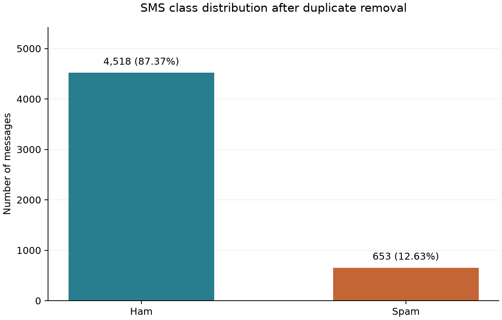

# Probability analysis results

All calculations use the 5,171 cleaned messages. The probability experiment selects one of these records uniformly at random.

## Class probabilities

- P(Spam) = 653 / 5171 = 0.12628118 (12.6281%).
- P(Ham) = 4518 / 5171 = 0.87371882 (87.3719%).

## Word probabilities

Words are matched case-insensitively using Python regular-expression word boundaries. Count presence once per message, not the number of repetitions. No stemming or substring matching is used.

| Word | Messages containing word | Spam | Ham | P(Word) | P(Word given Spam) | P(Spam given Word) | Bayes result |
| --- | ---: | ---: | ---: | ---: | ---: | ---: | ---: |
| free | 203 | 148 | 55 | 0.03925740 | 0.22664625 | 0.72906404 | 0.72906404 |
| prize | 73 | 73 | 0 | 0.01411719 | 0.11179173 | 1.00000000 | 1.00000000 |
| win | 55 | 49 | 6 | 0.01063624 | 0.07503828 | 0.89090909 | 0.89090909 |
| urgent | 62 | 57 | 5 | 0.01198994 | 0.08728943 | 0.91935484 | 0.91935484 |
| offer | 30 | 24 | 6 | 0.00580159 | 0.03675345 | 0.80000000 | 0.80000000 |

For a word W, let n(W) count messages containing it and n(Spam and W) count spam messages containing it.

- Direct calculation: P(Spam given W) = n(Spam and W) / n(W).
- Bayes calculation: P(Spam given W) = [P(W given Spam) × P(Spam)] / P(W).

For free: direct = 148 / 203 = 0.72906404. Bayes = [(148 / 653) × (653 / 5171)] / (203 / 5171) = 0.72906404. The notebook prints the equivalent substitution for every word and checks agreement to an absolute tolerance of 1e-12. Exported probabilities use 12 significant digits to avoid displaying floating-point roundoff.

All 73 cleaned messages containing the whole word prize are spam in this dataset. The observed probability of 1 does not guarantee that every future message containing prize is spam. These descriptive probabilities are not full-message model predictions.

## Random variable analysis

Y = 1 for spam and Y = 0 for ham. Thus Y has a Bernoulli distribution with p = 653 / 5171.

- E(Y) = 0 × (1 − p) + 1 × p = 0.12628118.
- Since Y² = Y, Var(Y) = E(Y²) − E(Y)² = p − p² = p(1 − p) = 0.11033425.

The mean and population variance of the numeric labels independently match these formulas. Population variance uses ddof=0, consistent with assigning equal probability to each of the 5,171 records.

## Scope

These results summarize the complete cleaned dataset for the assignment. They will not be used to tune the classifier against the test set. Training/test preparation and model evaluation remain for the next stage.
